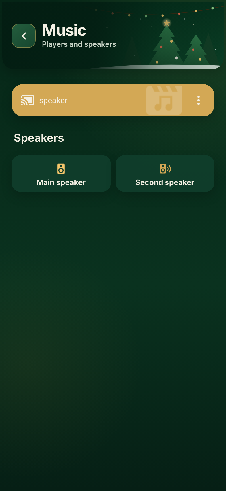

# Holiday Lair

Turn on the tree, run your Cozy scene, and check the door locks from one Home Assistant screen. Holiday Lair pairs your own devices and scenes with a pine-green dashboard and original snowy cabin artwork for the Companion app or a portrait kiosk tablet.

[Set up Holiday Lair](#quickstart) · [Browse the screens](#a-look-around)

## What it can do

- **Home and voice.** A greeting changes with the time of day. See the outdoor temperature, alarm state, and how many available doors are locked. Run Cozy, Party, or Night from the scene buttons. The Tree toggle and Talk to Assist are on the same screen.
- **Room and outdoor lights.** Dim individual lights in the Living Room and Kitchen. The Lights view also has separate toggles for the tree and porch.
- **Security.** Tap the home status strip to open Security. **Disarm, Home, and Away send real alarm commands when connected.** If your panel requires a code, hold an alarm button to open its dialog. Tapping a door tile opens its lock dialog, where you can operate the physical lock.
- **Music and climate.** Control the main player or open either speaker’s details. Check the current temperature, set a target, or select a supported HVAC mode.
- **Holiday automations.** Two optional blueprints can schedule the lights or play your own sound clip when the tree turns on. [Configure the blueprints](SETUP.md#6-optional-blueprints)
- **Kiosk navigation.** Kiosk Mode hides the header and sidebar on mobile. The gear opens a menu with shortcuts to Home, Settings, and standard navigation.

## Requirements

The template targets Home Assistant **2026.10 or newer** and requires [HACS](https://hacs.xyz/) with these five frontend extensions. The author tested on **2026.11.2** with demo entities in a phone-sized browser. Physical-phone and other-version testing is still pending.

| Install through HACS | Used for |
| --- | --- |
| [button-card](https://github.com/custom-cards/button-card) | Scene buttons, status strip, and navigation tiles |
| [Mushroom](https://github.com/piitaya/lovelace-mushroom) | Room lighting and brightness sliders |
| [card-mod](https://github.com/thomasloven/lovelace-card-mod) | Card styling |
| [layout-card](https://github.com/thomasloven/lovelace-layout-card) | Centered phone layout |
| [Kiosk Mode](https://github.com/NemesisRE/kiosk-mode) | Hide or restore standard navigation |

## Quickstart

1. **Install the five extensions** through HACS and refresh your browser or Companion app.
2. **Load the theme.** Copy [holiday-pine.yaml](themes/holiday-pine.yaml) into `/config/themes/`. Check that Home Assistant loads that directory. Restart after first enabling themes, or run `frontend.reload_themes` to refresh an existing setup.
3. **Copy the artwork** from [assets](assets/) into `/config/www/holiday-lair/`. Restart Home Assistant once if you just created `www/`.
4. **Create a new dashboard** in Settings → Dashboards and give it the URL `holiday-lair`.
5. **Connect your devices.** Replace the [18 placeholder entity IDs](SETUP.md#5-replace-the-placeholders) in a copy of [dashboard.yaml](dashboard.yaml) and remove unused tiles. Paste your edited YAML into the new dashboard’s **Raw configuration editor** and save.
6. **Check the home screen.** Open `/holiday-lair/home`. You should see the snowy cabin and the status strip. Tap **Lights → Living Room** and check the light cards against your devices before trying their controls.

The [full setup guide](SETUP.md) includes the theme configuration, every placeholder, tested card versions, and blueprint installation. To use another dashboard URL, change the navigation paths in the YAML and keep the artwork paths under `/local/holiday-lair/`.

## A look around

These screenshots come from a phone-sized browser on a test Home Assistant instance with demo entities. Select an image to see it at full size.

| Home | Living Room | Music |
| --- | --- | --- |
|  |  |  |

## One design decision

Every view selects the dark Holiday Pine theme, even when the phone uses light mode. The Mushroom light cards also set their label colors explicitly so you can still read “Lamp” against the pine-green surface. On the test instance the label kept a contrast ratio of 10.7:1 in both browser modes. All current text pairs checked by the palette script also meet the 4.5:1 WCAG AA threshold for normal text. [Theme](themes/holiday-pine.yaml) · [Contrast measurements](SETUP.md#contrast-check)

## Make it yours

- **Rooms and scenes.** Change the room titles, button names, and entity IDs in the dashboard YAML. For example, replace `light.tree_lights` with your tree’s light or light group. Keep the alarm action names when changing the alarm entity.
- **Colors and art.** Edit [the theme](themes/holiday-pine.yaml) and reload themes to try a new palette. The [contrast script](tools/contrast.py) prints ratios for the built-in palette and a low-contrast example from an earlier version. Run it with `python3 tools/contrast.py`. To change the cabin, pines, string lights, stars, or snow, replace the SVGs in `/config/www/holiday-lair/`. Keep their filenames or update the corresponding `/local/holiday-lair/` paths in the dashboard YAML.
- **Schedule the lights.** The optional [holiday lights blueprint](blueprints/automation/holiday_lair/holiday_lights_schedule.yaml) turns a chosen light on at sunset (with an optional offset) or at a fixed time, and off at the time you set. Select a toggle helper to pause the schedule after the holidays.
- **Bring your own sound clip.** The download includes the automation. You supply the audio file. Put a clip you own or have permission to use in `/media`. In the optional [tree-light sound blueprint](blueprints/automation/holiday_lair/tree_light_sound.yaml), choose the light, speaker, and clip under **My media**. On supported speakers you can set the volume and play the clip as an announcement.

## Troubleshooting

**How do I get the header and sidebar back?** Open the gear menu and choose **Show standard navigation**, or open `/holiday-lair/home?disable_km` on your Home Assistant instance.

**Why does a card say “Custom element doesn’t exist”?** Check that its HACS extension is installed and listed as a dashboard resource, then hard-refresh. In the Companion app, use **Settings → Companion app → Debugging → Reset frontend cache**.

**Why do the theme colors look wrong?** Check that the theme file is in `/config/themes/` and that `configuration.yaml` loads that directory. Run `frontend.reload_themes` under **Developer tools → Actions**. Every dashboard view already selects `holiday-pine`. [Theme setup](SETUP.md#2-theme)

## Credits and license

Holiday Lair is by **Jason Clark**. The dashboard layout, theme, original artwork, and blueprints are free to use and adapt under the [MIT License](LICENSE). Thanks to the maintainers of button-card, Mushroom, card-mod, layout-card, and Kiosk Mode. Each extension is distributed separately under its own license.

Holiday Lair is a generic holiday theme. It is not affiliated with or endorsed by Home Assistant, the Open Home Foundation, or any card author, film, book or brand. The template is provided as is, without warranty.

[Holiday Lair build notes on Forkthis](https://forkthis.ai/holiday-lair/)
