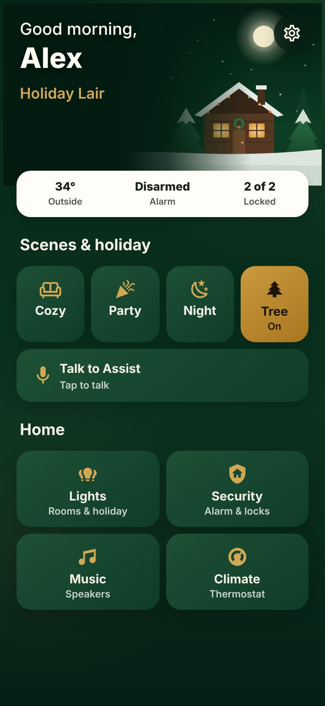
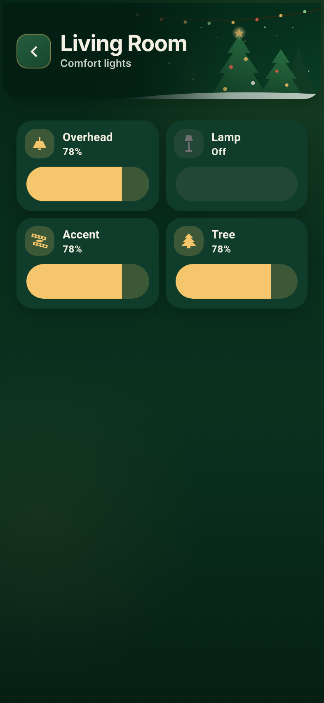

# Holiday Lair

A cozy pine-green holiday dashboard for Home Assistant, built for your phone.

## Why Holiday Lair?

When you settle in for the evening, the tree lights, your favorite scene, and a glance at the door locks belong on the same screen. Holiday Lair puts them within reach in the Companion app or on a portrait kiosk tablet. Bring your own devices and scenes. The layout, dark Holiday Pine theme, and original snowy cabin artwork come with the template.

## A look around

These screenshots come from a phone-sized browser on a test Home Assistant instance with demo entities. Select an image to see it at full size.

| Home | Living Room | Music |
| --- | --- | --- |
|  |  |  |

- **Home.** A greeting changes with the time of day. Check the outdoor temperature, alarm state, and lock count. Tap Cozy, Party, or Night, toggle the tree lights, or use Talk to Assist.
- **Lights and security.** Open the Living Room or Kitchen for Mushroom brightness sliders. The Security view has Disarm, Arm Home, Arm Away, and two door-lock tiles.
- **Music and climate.** Use the media player and speaker shortcuts, or open the built-in thermostat card.
- **Holiday Pine.** The dark theme pairs warm gold controls with original SVG pines, string lights, stars, and snow. The current text color pairs meet the WCAG AA contrast threshold for normal text. [Check the palette](tools/contrast.py).
- **Kiosk mode.** The header and sidebar tuck away. The gear menu brings them back when you need to edit.

## Requirements

Home Assistant **2026.10 or newer** and [HACS](https://hacs.xyz/) with these five frontend extensions. The author tested on **2026.11.2** using a phone-sized browser. Physical-phone testing is still pending.

| Install through HACS | Used for |
| --- | --- |
| [button-card](https://github.com/custom-cards/button-card) | Scene buttons, status strip, and navigation tiles |
| [Mushroom](https://github.com/piitaya/lovelace-mushroom) | Room lighting and brightness sliders |
| [card-mod](https://github.com/thomasloven/lovelace-card-mod) | Card styling |
| [layout-card](https://github.com/thomasloven/lovelace-layout-card) | Centered phone layout |
| [Kiosk Mode](https://github.com/NemesisRE/kiosk-mode) | Hide or restore standard navigation |

## Quickstart

1. **Install the five extensions** through HACS and refresh your browser or Companion app.
2. **Load the theme.** Copy [holiday-pine.yaml](themes/holiday-pine.yaml) into `/config/themes/`. Check that Home Assistant loads that directory, then run `frontend.reload_themes`.
3. **Copy the artwork** from [assets](assets/) into `/config/www/holiday-lair/`. Restart Home Assistant once if you just created `www/`.
4. **Create a new dashboard** in Settings → Dashboards. Give it the URL `holiday-lair`. In its **Raw configuration editor**, paste [dashboard.yaml](dashboard.yaml).
5. **Connect your devices.** Replace the 18 placeholder entity IDs with your own, remove unused tiles, and save. Review the alarm and lock controls before trying them on a real system. The alarm buttons send real arm and disarm commands. Each door tile opens its lock dialog, where an action can operate the physical lock.

The [full setup guide](SETUP.md) includes the theme configuration, every placeholder, tested card versions, and instructions for using a different dashboard URL.

## Make it yours

- **Rooms and scenes.** Change the room titles, button names, and entity IDs in the dashboard YAML. For example, replace `light.tree_lights` with your tree’s light or light group. Keep the alarm action names when changing the alarm entity.
- **Colors and art.** Edit [the theme](themes/holiday-pine.yaml) and reload themes to try a new palette. To change the cabin or pines, replace the SVGs in `/config/www/holiday-lair/`. Keep their filenames or update the corresponding `/local/holiday-lair/` paths in the dashboard YAML.
- **Schedule the lights.** The optional [holiday lights blueprint](blueprints/automation/holiday_lair/holiday_lights_schedule.yaml) turns a chosen light on at sunset or at a fixed time and off at the time you set.
- **Bring your own sound clip.** For a sound when the tree comes on, put a clip you own or have permission to use in `/media`. In the optional [tree-light sound blueprint](blueprints/automation/holiday_lair/tree_light_sound.yaml), choose the light, speaker, and clip under **My media**. The download contains no audio.

## Troubleshooting

**How do I get the header and sidebar back?** Open the gear menu and choose **Show standard navigation**, or open `/holiday-lair/home?disable_km` on your Home Assistant instance.

**Why does a card say “Custom element doesn’t exist”?** Check that its HACS extension is installed and listed as a dashboard resource, then hard-refresh. In the Companion app, use **Settings → Companion app → Debugging → Reset frontend cache**.

**Why do the theme colors look wrong?** Check that the theme file is in `/config/themes/` and that `configuration.yaml` loads that directory. Run `frontend.reload_themes` under **Developer tools → Actions**. Every dashboard view already selects `holiday-pine`. [Theme setup](SETUP.md#2-theme)

## Credits and license

Holiday Lair is by **Jason Clark**. The dashboard layout, theme, original artwork, and blueprints are free to use and adapt under the [MIT License](LICENSE). Thanks to the maintainers of button-card, Mushroom, card-mod, layout-card, and Kiosk Mode. Each extension is distributed separately under its own license.

Holiday Lair is a generic holiday theme. It is not affiliated with or endorsed by Home Assistant, the Open Home Foundation, or any card author, film, book or brand. The template is provided as is, without warranty.
